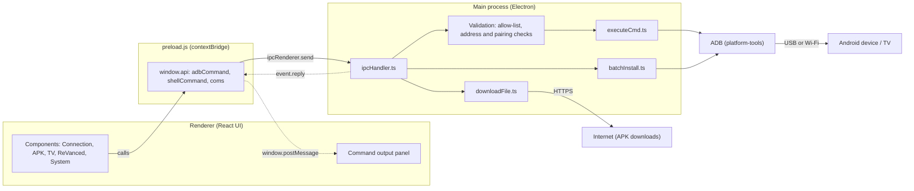
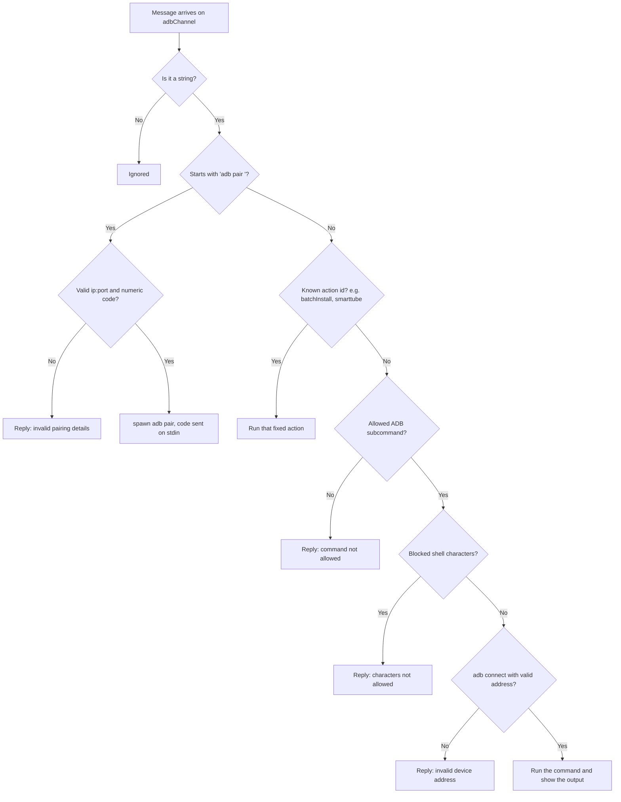
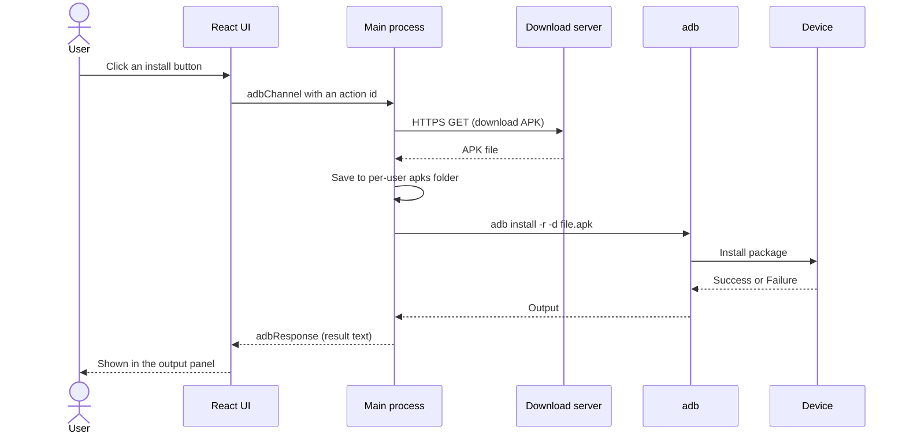
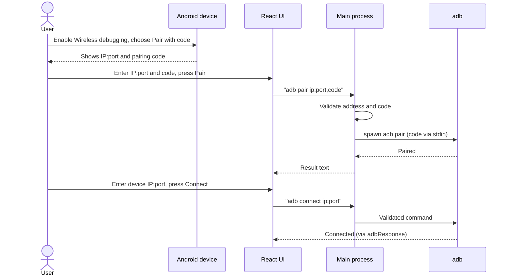
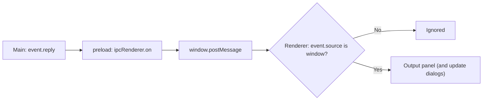
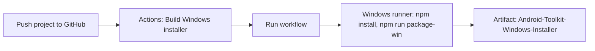
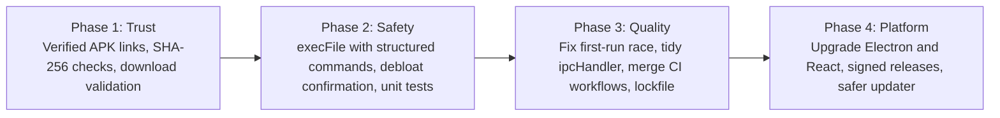

# Android Toolkit

A desktop dashboard for managing Android phones, Android TV and Fire TV devices through **Android Debug Bridge (ADB)**. Built with Electron, React and TypeScript.


> **Status:** v2.0.0 source rebuild. The Windows installer has not been built yet and the GitHub Actions workflows have not been run. See [Known limitations](#known-limitations).

## Table of contents

- [Features](#features)
- [Architecture](#architecture)
- [Key flows](#key-flows)
- [Tech stack](#tech-stack)
- [Getting started](#getting-started)
- [Project structure](#project-structure)
- [Security design](#security-design)
- [Known limitations](#known-limitations)
- [Roadmap](#roadmap)
- [Analysis notebook](#analysis-notebook)
- [Responsible use](#responsible-use)
- [Credits and license](#credits-and-license)

---

## Features

| Module | What it does |
|---|---|
| **ADB Connection** | Wireless pairing, connect / disconnect, list devices, recent IP addresses |
| **APK Tools** | Install a single APK, batch-install every APK in a folder, one-click installs of selected apps |
| **TV Tools** | Screensaver timeout settings, Fire TV debloat list |
| **ReVanced Tools** | Helpers for installing MicroG, ReVanced Manager and patchable APKs |
| **System Tools** | Device info (battery, memory, CPU, Wi-Fi, disk, OS version), screenshot, terminal shortcut |
| **Command output panel** | Shows the result of every action inside the app |

---

## Architecture

The app follows the standard Electron split: a React UI in the **renderer**, a **preload** script that exposes a small API, and a **main process** that is the only part allowed to run ADB or download files.



### IPC channels

| Channel | Direction | Accepts |
|---|---|---|
| `adbChannel` | UI → main | ADB commands (validated), `adb pair <ip:port>,<code>`, `batchInstall`, and named one-click installs |
| `shellChannel` | UI → main | Only `powershell`, `terminal` or `update` |
| `communicationChannel` | UI → main | `restart` |
| `adbResponse`, `shellResponse`, `startup` | main → UI | Text shown in the output panel |

---

## Key flows

### 1. Command validation (`adbChannel`)

Every ADB command from the UI goes through these checks before anything runs.



### 2. One-click APK install



### 3. Wireless pairing and connecting



### 4. Where the output goes



---

## Tech stack

- **Electron** main process with a context-isolated preload bridge
- **React 17 + TypeScript** with Material UI
- **Webpack** (Electron React Boilerplate layout)
- **electron-builder** for Windows (NSIS), macOS and Linux (AppImage)
- **Jest + Testing Library** for tests

---

## Getting started

### Requirements

- Node.js 20 LTS and npm
- Android platform-tools (ADB). The packaged Windows app downloads them on first run. In development, `adb` must be on your `PATH`.
- A device with **Developer options** and **USB debugging** (or **Wireless debugging**) enabled

### Run in development

```bash
git clone https://github.com/harpreetsingh171190-cmyk/Android-Toolkit.git
cd Android-Toolkit
npm install
npm start
```

### Build an installer

```bash
npm run package-win      # Windows (run on Windows)
npm run package          # current OS
```

The result is written to `release/build/`. Build on the operating system you are targeting.

### Build with GitHub Actions



> Commit `package-lock.json` after your first `npm install` so CI can use reproducible installs.

### Connection checklist

1. Enable Developer options and USB debugging on the device.
2. Connect by USB, or enable Wireless debugging and pair first.
3. Accept the debugging prompt on the device.
4. Click **List Devices** to confirm the connection before installing anything.

---

## Project structure

```
Android-Toolkit/
├── src/
│   ├── main/                 Electron main process
│   │   ├── api/              ipcHandler.ts (IPC routes)
│   │   ├── utils/            executeCmd, downloadFile, batchInstall, appUpdater
│   │   ├── constants/        paths, URLs, platform settings
│   │   ├── main.ts           app start, window, ADB server start
│   │   ├── menu.ts           application menu
│   │   └── preload.js        contextBridge API
│   ├── renderer/             React UI
│   │   ├── components/       Connection, APK, TV, ReVanced, System actions
│   │   ├── constants/        debloat command list
│   │   └── App.tsx, App.css
│   └── __tests__/            Jest tests
├── .erb/                     Webpack configs and build scripts
├── .github/workflows/        quality check, installer build, release publish
├── assets/                   icons and ASCII art
├── release/app/package.json  packaged app metadata
└── install.sh                macOS / Linux installer script
```

---

## Security design

- The UI has no direct Node.js access. It talks to the main process only through `contextBridge`.
- `shellChannel` accepts a fixed set of actions (`powershell`, `terminal`, `update`).
- ADB commands from the UI are checked against an allow-list and a blocked-character list. `adb connect` addresses and pairing codes are validated.
- `adb pair` runs with `spawn` and the code is sent on stdin, so no shell is involved.
- The renderer only accepts messages whose source is its own window.
- Production builds ship with a Content Security Policy.
- APKs are saved in the per-user app data folder.
- The in-app updater stays disabled until `repository.url` in `package.json` points to your own repository.

---

## Known limitations

These come from a code review of this source (see `Android-Toolkit-Review.md` and the analysis notebook).

- **Electron 25 is end-of-life.** Upgrade it before publishing a release.
- **Third-party APK links are not verified.** Several links in `src/main/constants/index.ts` point to Google Drive, a temporary MediaFire URL, forum attachments or mirror sites. Check each link yourself and prefer official GitHub releases. Downloads currently have no hash or file-type check.
- **Commands run through a shell string** (`exec`). The validator blocks common shell characters but also rejects some valid file names, such as `R&D.apk`. The planned fix is `execFile` with argument arrays.
- The Fire TV **debloat button runs 60 `pm disable-user` commands at once** with no confirmation. Use it only on devices you own and understand.
- On first Windows launch, the ADB server may start before the platform-tools download finishes.
- Only one smoke test exists. Validator unit tests are on the roadmap.
- The macOS / Linux updater runs `install.sh` from the repository's `main` branch. Replace it with signed release assets before distributing the app.

---

## Roadmap



- [ ] Replace unverified APK links; add SHA-256 checks and download validation
- [ ] Switch to `execFile` with structured commands
- [ ] Add a confirmation step and sequential run for debloat
- [ ] Unit tests for validators and URL handling
- [ ] Upgrade Electron, React and build tooling
- [ ] Verify and merge the CI workflows; commit the lockfile
- [ ] Signed releases and a safer updater

---

## Analysis notebook

`Android_Toolkit_Analysis_EN.ipynb` reads the project zip and reports file and line counts, dependencies, IPC channels, ADB commands, download-link sources and a test of the command validator. It runs in Google Colab (it asks you to upload the zip) or in local Jupyter with the zip next to the notebook. It reads source code only. It never runs ADB and never opens any link.

---

## Responsible use

Use this tool only on devices you own or are authorized to manage. Some actions (debloat, system settings) can disable device features, so back up important data first. Third-party apps and links can change or disappear; download software only from sources you trust.

---

## Credits and license

This project is based on the open-source **Android Toolkit** by **Anthony Gress**, released under the MIT License. The v2.0.0 rebuild updates the dashboard UI and applies review fixes. The original copyright notice is kept in [LICENSE](LICENSE).

Released under the [MIT License](LICENSE).
